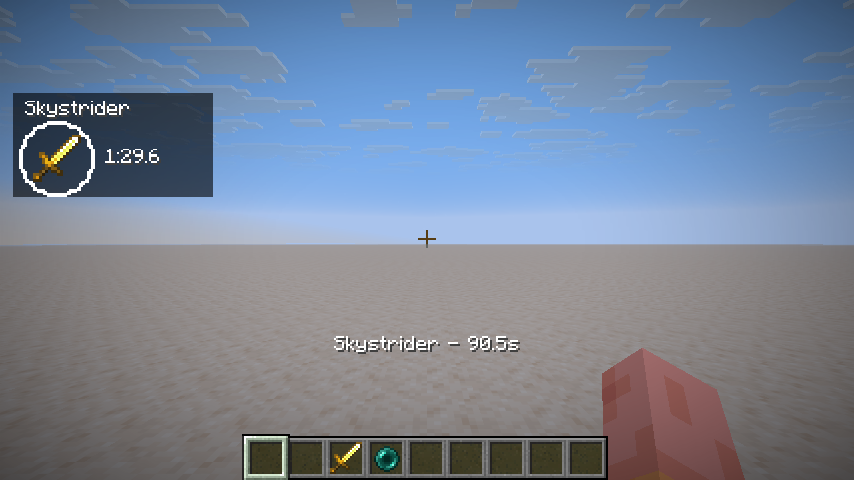
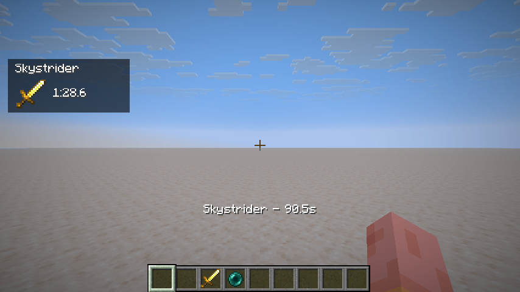
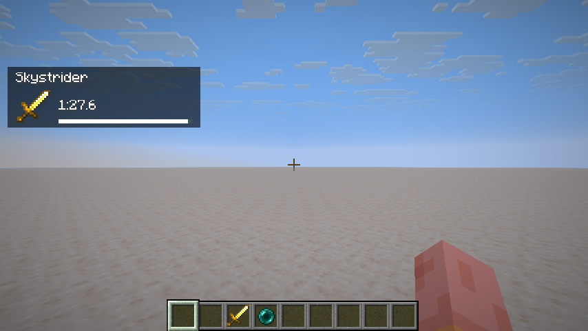
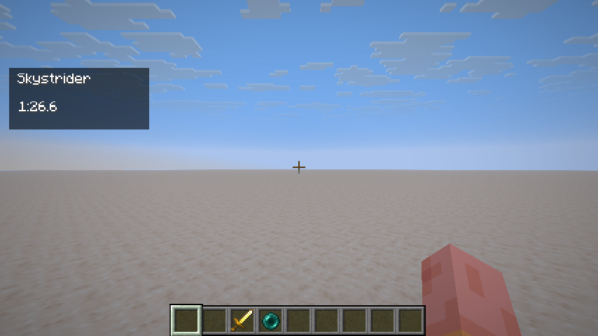
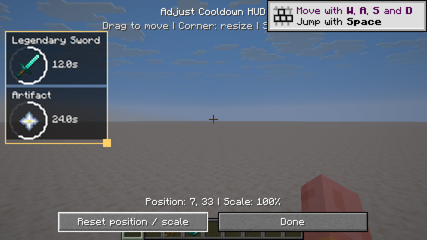
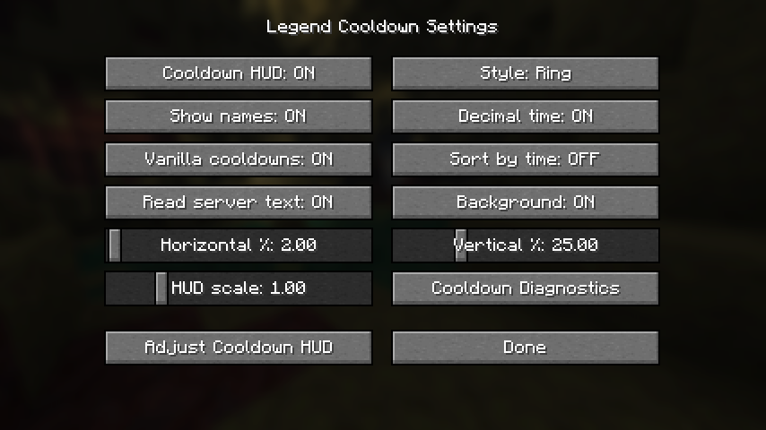
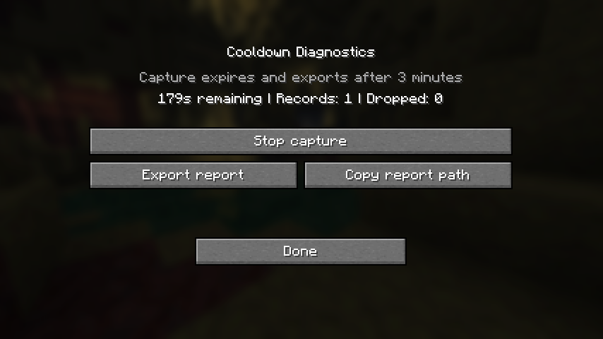

# Legend Cooldown · 传奇武器冷却

在游戏画面中查看传奇武器、神器和物品的剩余冷却时间，并用鼠标自由摆放 HUD。

Legend Cooldown 是从 EmbersClient 冷却模块拆出的独立 **Fabric 客户端 MOD**，支持 **Minecraft 1.21.11、26.1.2、26.2**。设置与诊断界面使用原版控件，保留原版字体和 F3 调试界面。

**[下载最新版](https://github.com/EmbersDrift/LegendCoolDown/releases/latest)** · [查看更新](https://github.com/EmbersDrift/LegendCoolDown/releases) · [反馈问题](https://github.com/EmbersDrift/LegendCoolDown/issues)

## 游戏内效果

以下图片来自 Minecraft 26.2 本地测试世界的实际运行，使用英文界面与测试冷却数据。MOD 同时提供中文界面。

### 四种显示样式

| 圆环 | 图标 |
| --- | --- |
|  |  |
| **进度条** | **仅时间** |
|  |  |

名称、时间小数、背景与剩余时间排序均可独立调整。

### 用鼠标调整 HUD

按 **H** 打开编辑器。左键拖动模块可向任意方向移动；拖动右下角的小方块，或将鼠标放在模块上滚动滚轮，即可缩放。



- 支持 50%～300% 缩放，并按屏幕空间限制大小和位置。
- 没有冷却或 HUD 已关闭时，也能通过固定预览调整布局。
- 冷却条目增减时保持编辑后的左上角锚点，超出屏幕时自动限制位置。
- 松开鼠标或退出界面后自动保存；“重置位置与缩放”可恢复默认布局。

<details>
<summary>查看原版风格的设置与诊断界面</summary>

按 **K** 打开设置，调整样式、名称、时间显示、原版冷却同步和服务器文本识别，也可从这里进入 HUD 编辑器。



诊断默认关闭，需要排查未识别的冷却时可手动开始记录，停止或超时后导出本地报告。



</details>

## 安装

1. 为目标 Minecraft 版本安装 **Fabric Loader 0.19.5 或更新版本**。
2. 安装与该 Minecraft 版本对应的 **Fabric API**。
3. 下载下表中对应的 **一个** JAR，放进该游戏实例的 `mods` 文件夹，启动游戏。

| Minecraft | Java | 下载 1.1.0 |
| --- | --- | --- |
| **1.21.11** | 21 或更新 | [LegendCoolDown-1.1.0+mc1.21.11.jar](https://github.com/EmbersDrift/LegendCoolDown/releases/download/v1.1.0/LegendCoolDown-1.1.0%2Bmc1.21.11.jar) |
| **26.1.2** | 25 或更新 | [LegendCoolDown-1.1.0+mc26.1.2.jar](https://github.com/EmbersDrift/LegendCoolDown/releases/download/v1.1.0/LegendCoolDown-1.1.0%2Bmc26.1.2.jar) |
| **26.2** | 25 或更新 | [LegendCoolDown-1.1.0+mc26.2.jar](https://github.com/EmbersDrift/LegendCoolDown/releases/download/v1.1.0/LegendCoolDown-1.1.0%2Bmc26.2.jar) |

Release 同时提供 [SHA256SUMS.txt](https://github.com/EmbersDrift/LegendCoolDown/releases/download/v1.1.0/SHA256SUMS.txt) 校验文件。更新时请移除旧版 Legend Cooldown JAR，避免同时安装两个版本。

此 MOD 只需安装在客户端，无需 EmbersClient、Live Hider 或 TeamViewer。若已安装带有同一冷却模块的 EmbersClient，应使用独立版替代对应模块，避免重复注册协议通道。

## 快捷操作

| 操作 | 默认按键或方式 |
| --- | --- |
| 打开设置 | **K** |
| 打开 HUD 编辑器 | **H**，或设置中的“调整冷却 HUD” |
| 移动模块 | 按住模块内的鼠标左键拖动 |
| 缩放模块 | 拖动右下角手柄，或在模块上滚动滚轮 |
| 保存并返回 | “完成”或 **Esc** |
| 隐藏游戏 HUD | 原版 **F1** |

快捷键可在原版“选项 → 控制 → 按键绑定”中修改。位置与缩放也可在设置页通过滑块调整。

## 支持的冷却来源

- **Apollo JSON / protobuf**：读取服务器发送的冷却显示、移除与重置消息。
- **旧版 Lunar 协议**：兼容旧式冷却消息。
- **原版物品冷却**：与服务器冷却合并显示，对应同一组冷却时去重。
- **服务器文本**：识别已支持格式的动作栏、系统消息、Boss 栏及动态物品说明。
- **物品外观**：保留已匹配物品的模型组件；移动或消耗物品后，计时中的图标仍保留。

同时安装 TeamViewer 时，会沿用其 Apollo 接收器共享方式。冷却时间来自服务器明确发送的数据、原版状态或已确认的时长；只发生物品交互而没有时长与确认信号时，不会凭空生成计时。

## 常见问题

### 装好后为什么没有显示冷却？

HUD 在有可识别的冷却时显示。可先按 **H** 查看预览，确认模块的位置和大小，再检查设置中是否开启“冷却 HUD”及所需的冷却来源。服务器未发送冷却数据，或采用尚未支持的格式时，需要对应协议或文本样本才能适配。

### 如何反馈某把武器不显示冷却？

在 **K → 冷却诊断** 中开始记录，关闭界面后使用该物品，再回来停止记录并导出。记录最多持续 3 分钟、保留 2000 条；停止、超时或断开连接时自动导出到 `logs/legendcooldown-diagnostics-*.json`。

报告可能包含服务器地址、背包物品及冷却文本。提交公开 Issue 前请先检查并删去不希望公开的信息。MOD 没有订阅玩家聊天事件，诊断默认关闭。

### 设置保存在哪里？

`config/legendcooldown.json`。旧版整数位置配置仍可读取，首次鼠标调整时自动转换为更精确的屏幕锚点定位。

## 构建与验证

安装 **JDK 25 或更新版本**，在项目根目录执行：

```powershell
# Windows
.\gradlew.bat build
```

```sh
# Linux / macOS
bash ./gradlew build
```

三个发行 JAR 输出至 `dist/`。`mc12111`、`mc2612`、`mc262` 为三个版本的构建项目；共享源码位于 `src/client/java/`。

当前各版本均通过 **25 项单元测试和 37 项客户端／本地游戏内检查**。开发验证使用独立本地世界，未进行线上服务器实测。

| 文档 | 内容 |
| --- | --- |
| [验证记录与各版本截图](docs/VERIFICATION.md) | 测试范围、结果及三个版本的游戏截图 |
| [迁移说明](docs/MIGRATION.md) | 模块来源、独立化边界与版本差异 |
| [敏感信息检查](docs/SECURITY_REVIEW.md) | 上传前检查范围与忽略规则 |

## 来源与许可

冷却逻辑源自 EmbersClient 的完整冷却模块，HUD 编辑交互参考其编辑器，独立版界面采用原版控件重写。

项目沿用上游的 **All-Rights-Reserved** 标记。源码公开不等于授予开放源代码许可证；本仓库不额外授予上游代码的再分发许可。
